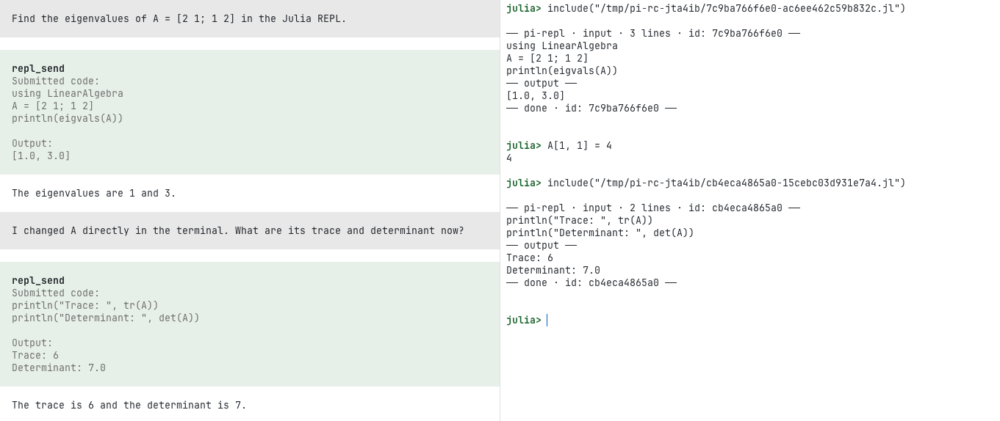

# pi-repl

A [Pi](https://pi.dev) extension for REPL sessions that you and Pi share. pi-repl starts a Python, IPython, Julia, R, Haskell (GHCi), Clojure, Ruby, Java, Octave, MATLAB or gnuplot REPL, or an experimental C++ (Cling), Rust (evcxr) or Fortran (LFortran) one, in tmux. You attach to it from another terminal and work there as normal, and Pi runs code in the same session, so you both work with the same variables.

<picture>
  <source media="(prefers-color-scheme: dark)" srcset="./shared-julia-repl-dark.png">
  
</picture>

*Pi (left) and the same Julia workspace in an attached terminal (right). The second request uses a matrix changed directly in the terminal.*

To follow a session in the browser, use the REPL page of [pi-markdown-preview](https://github.com/omaclaren/pi-markdown-preview) (`/preview-browser --repl`) or [agent-markdown-preview](https://github.com/omaclaren/agent-markdown-preview) (`agent-markdown-preview --repl`). It shows who sent each submission, its code and output, and any plots it saved, as they arrive. [Pi Studio](https://github.com/omaclaren/pi-studio), a browser workspace for Pi, also shows the sessions in its REPL view and can send code to them.

[agent-repl](https://github.com/omaclaren/agent-repl) gives Claude Code, Codex, OpenCode and other agents the same sessions, and its [one-minute demo](https://omaclaren.github.io/agent-repl/#demo) shows Pi, a person and Claude Code sharing a Python session, with the browser page showing their code and plots.

## Install

```bash
pi install npm:pi-repl
```

or `pi install https://github.com/omaclaren/pi-repl`, then restart Pi. pi-repl needs tmux and is mainly tested on macOS. On Windows, run Pi, tmux and the interpreters inside WSL.

## Getting started

Start a session from Pi:

```text
/repl julia
```

and attach to it from another terminal:

```bash
tmux attach -t pi-repl-julia
```

(`/repl attach julia` prints that command.) Then type into the terminal yourself, or ask Pi to use the session, for example "in the shared Julia REPL, find the eigenvalues of [2 1; 1 2]". Pi can also start a session when you ask it to ("start a shared Ruby REPL").

## Runtimes

| Runtime | Name in commands | Needs | tmux session |
|---------|------------------|-------|--------------|
| Python | `python` | `python` | `pi-repl-python` |
| IPython | `ipython` | `ipython` | `pi-repl-python` |
| Julia | `julia` | `julia` | `pi-repl-julia` |
| R | `r` or `R` | `R` | `pi-repl-r` |
| Haskell | `ghci` | `ghci` | `pi-repl-ghci` |
| Clojure | `clojure` or `clj` | `clojure` | `pi-repl-clojure` |
| Ruby | `ruby` | `irb` | `pi-repl-ruby` |
| Java | `java` | a JDK with `jshell` | `pi-repl-java` |
| Octave | `octave` | `octave-cli` | `pi-repl-octave` |
| MATLAB | `matlab` | a licensed `matlab` | `pi-repl-matlab` |
| gnuplot | `gnuplot` | `gnuplot` | `pi-repl-gnuplot` |
| C++ (experimental) | `cpp` | `cling` | `pi-repl-cpp` |
| Rust (experimental) | `rust` | `evcxr` | `pi-repl-rust` |
| Fortran (experimental) | `lfortran` | `lfortran` built from `main` | `pi-repl-lfortran` |

Sessions start through your normal interactive login shell, in Pi's working directory, so they find the interpreters you use yourself. pi-repl doesn't install or repair them. Python and IPython share one session. The [runtime notes](docs/runtimes.md) say how each runtime takes submitted code and what to expect from it.

### C++ (experimental)

`cpp` runs Cling. Send code as you would type it at Cling's prompt, with a function's opening brace on its declaration line, and load ordinary source files with `#include`. Earlier groups of lines can run before a later one fails, and nothing is rolled back. It has been tested with Cling 1.3 on ARM64 macOS.

### Rust (experimental)

`rust` runs evcxr's own REPL (`cargo install evcxr_repl`). pi-repl pastes each of Pi's cells whole at evcxr's prompt, under a `// pi-repl <id>` comment line, and only when evcxr is waiting with nothing typed: while a cell runs, or once you have started typing, nothing is sent and Pi is told why. In evcxr 0.22.0, input that arrives while a cell runs can be lost, so don't type then; the fix is in evcxr's `main`, for its next release. It has been tested with evcxr 0.22.0 and evcxr's `main` on ARM64 macOS.

### LFortran sessions (experimental)

`lfortran` needs a build of LFortran's `main` branch with its shared session (`lfortran --connect`); no release has it yet. You work at LFortran's own prompt in the session's first window, and Pi's cells go to the same kernel through pi-repl's helper in the second, so you share variables and procedures. When one of Pi's cells reaches a READ, Pi answers with `repl_input`, or you can with `/repl input <text>`. Cells you run at your own prompt aren't recorded, so the agent isn't told of them.

For now, a runtime error in any cell ends the session for everyone, a cell's output arrives when it ends, and a running cell can't be interrupted.

## Commands

| Command | What it does |
|---------|--------------|
| `/repl <runtime>` | Start a session, or reuse the one running |
| `/repl status [runtime]` | Show the running sessions, or one session |
| `/repl attach [runtime]` | Show the command to attach from another terminal |
| `/repl send [runtime]` | Run the code on the lines below it (in Python if no runtime is named) |
| `/repl input <text>` | Answer the READ an LFortran cell is waiting on |
| `/repl env` | Show the Python session's interpreter and environment |
| `/repl echo [off\|summary\|full]` | Show or change how sends appear in the pane |
| `/repl name [<name>\|--clear]` | Show, save or clear the name your sends are recorded under |
| `/repl export [runtime]` | Write a session's record as Markdown |
| `/repl stop [runtime]` | Stop a session |

`/repl` alone shows usage, and `/lab` is an alias. Without a runtime, `attach`, `export` and `stop` use the only running session, and `attach` lists them all when several are running.

`/repl send` runs your own code, as Pi's `repl_send` runs the agent's. Shift+Enter starts a new line:

```
/repl send julia
for i in 1:3
    println(i)
end
```

The result goes into the conversation as a message, which the agent sees at its next turn. It doesn't start a turn. If the code is still running after 20 seconds, the command stops waiting and posts the result when the code finishes.

Your `/repl send` and `/repl env` are recorded under your name ("Oliver · via Pi"). `/repl name Oliver` saves it in `~/.config/pi-repl/person.json` (under `$XDG_CONFIG_HOME` when that's set), where agent-repl finds it too. `PI_REPL_USER_NAME` overrides it for one process, and without either, sends are recorded as `User`. Names are self-declared, so they suit people who trust each other, not auditing.

## Tools Pi uses

You can ask in plain language, and Pi picks the tool and its parameters.

| Tool | What it does |
|------|--------------|
| `repl_start` | Start or reuse a session for a given runtime, and wait for its prompt |
| `repl_status` | Show which sessions are running, with their record and history |
| `repl_send` | Run code in a running session |
| `repl_input` | Answer the READ an LFortran cell is waiting on |
| `repl_history` | Read a session's record: a list of its entries, or one in full |

`repl_start` reuses a running session as it is, keeping its variables and working directory. `repl_send` needs the session running and at its prompt, and never starts, restarts or switches one. If code runs past a send's timeout, Pi stops waiting but the code keeps running, and its output is recorded when it finishes. A result is limited to 2,000 lines or 50 KiB; a longer one is saved to a private file. Pi's tools can't stop or restart a session; that's left to you.

## What the agent is told

For the sessions it has started or sent to, the agent is also told what has happened since it last looked. This comes when a run starts (you send a prompt while the agent is idle) and with each `repl_send` result. It includes pane text the agent hasn't seen, such as what you typed or output that arrived late, and other clients' entries in the shared record: your sends from another Pi conversation, `agent-repl send`, Pi Studio's sends and notes, and other agents' sends, each with who sent it, its code and its output. Pane text is labelled as untrusted terminal text, and entries as data, not instructions. At a run's start, Pi shows you each as one line, and Ctrl+O shows the rest.

So pane text, including anything you type there, and other people's code and output reach the agent's model provider, even with a prompt that has nothing to do with the REPL. `PI_REPL_PANE_ACTIVITY` and `PI_REPL_RECORD_ACTIVITY` ([Settings](#settings)) limit this to sends, or turn it off. [How pi-repl works](docs/details.md#what-the-agent-is-told) gives the limits and timing.

## The shared record

Each session keeps a record of the code sent through pi-repl, agent-repl and Pi Studio: who sent it and how, its status, the code and its output, up to the latest 300 entries. Clients take turns, so one send can't take another's output. Code typed straight into the terminal isn't in the record. It is in the session's raw history, and it reaches the agent as pane text.

The browser REPL pages [above](#pi-repl) show the record as it grows, and `/repl export [runtime]` writes it as Markdown to a new file in Pi's working directory.

The record is kept under `TMPDIR`. A terminal with a different `TMPDIR` from the one that made the record, as an ssh login can have, can't send to the session, and `/repl status` says why.

## Pane display

By default, each send shows its code in the pane, between a header and a `done` line, so you can see what was run. Code is shown in full up to 20 lines or 2,000 characters, and shortened beyond that. `/repl echo full` raises the limit to 40 lines or 4,000 characters, and `/repl echo off` leaves the display out, so the pane shows only the short command that loads the code. The display doesn't change what runs, and it's removed from the captured output and the record.

## Stopping

Sessions keep running until you stop them, even when Pi exits or reloads. `/repl stop [runtime]` ends a session, discarding its state, and checks that its runtime has exited. It signals only processes it can confirm belong to the session, never by name, and says when it can't confirm something. Raw history and the record stay on disk. [How pi-repl works](docs/details.md#stopping-safely) has the details.

## Settings

Set these in Pi's environment before starting it.

| Variable | Values | Effect |
|----------|--------|--------|
| `PI_REPL_PANE_ACTIVITY` | `on` (default), `send`, `off` | Give the agent pane text it hasn't seen at run starts and with sends, with sends only, or never |
| `PI_REPL_RECORD_ACTIVITY` | `on`, `send`, `off` | The same for other clients' record entries; follows `PI_REPL_PANE_ACTIVITY` when unset |
| `PI_REPL_ECHO_MODE` | `summary` (default), `full`, `off` | The pane display at startup |
| `PI_REPL_USER_NAME` | a name | Record your sends under this name |
| `PI_REPL_AGENT_LABEL` | a label | The agent's name in the record when these tools run outside Pi (`Pi` by default) |

## Related tools

- [Pi Studio](https://github.com/omaclaren/pi-studio) is a browser workspace for Pi. Its REPL view sends to the same sessions and shares the record. With both loaded, the agent is told of each entry once, and each extension also works alone.
- [pi-markdown-preview](https://github.com/omaclaren/pi-markdown-preview) previews Pi's responses in the browser, and its REPL page follows each session's record.
- [agent-repl](https://github.com/omaclaren/agent-repl) is pi-repl running outside Pi: an MCP server and an `agent-repl` command for Claude Code, Codex, OpenCode and other agents, using the same sessions and record.
- [agent-markdown-preview](https://github.com/omaclaren/agent-markdown-preview) is the browser preview for Claude Code, Codex, Pi and OpenCode sessions, with the same REPL page.
- [pi-interactive-shell](https://github.com/nicobailon/pi-interactive-shell) runs interactive command-line programs in Pi, with an overlay you can take over.

## Development

Development uses Pi 1.5 and Node.js 22.19 or later.

```bash
npm ci
npm run typecheck
npm test
```

The tests use their own tmux servers, temporary homes and private files, never your REPLs, and check that every runtime they start has exited. Runtimes other than Python are tested when you select them, and missing ones are skipped:

```bash
PI_REPL_TEST_RUNTIMES=all npm test
PI_REPL_TEST_RUNTIMES=julia,r npm run test:integration
```

To try a checkout in Pi, replace the npm install with the local path (`pi remove npm:pi-repl`, then `pi install /path/to/pi-repl`) and restart Pi. Restart it again after changing the shared JavaScript, since `/reload` can keep the old modules. [How pi-repl works](docs/details.md#tests) has more on the tests.

## Acknowledgements

Ruby and Java support builds on [Ifiht's contribution in PR #2](https://github.com/omaclaren/pi-repl/pull/2), adapted to the current execution, display and recording machinery.

## License

MIT
